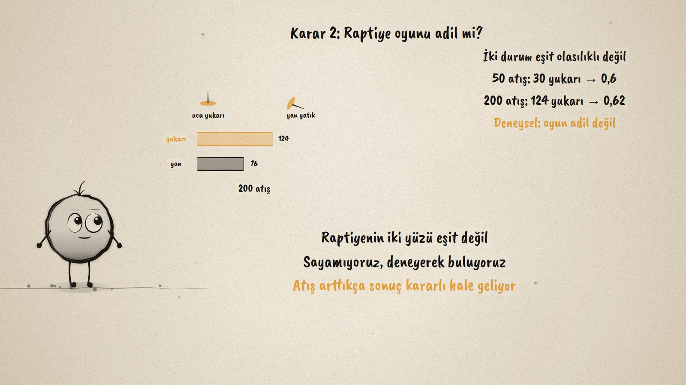
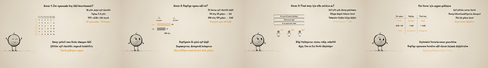

# Hangi Olasılık? · Which Probability?

**▶ Tarayıcıda izleyin / Watch in the browser:** https://hakanatas.github.io/hangi-olasilik/ 
**⬇ MP4 + altyazılar / MP4 + subtitles:** [Releases](https://github.com/hakanatas/hangi-olasilik/releases) 
**✎ Kullanılan istem / The prompt behind it:** [PROMPT.md](PROMPT.md) 
**🎞 Bütün filmler / All films:** [Nokta'nın Filmleri](https://hakanatas.github.io/nokta-filmleri/?sinif=8)

> **TR —** 8. sınıf matematik "Veriden Olasılığa" temasındaki MAT.8.7.1 öğrenme çıktısı için hazırlanmış, tamamen JavaScript ile çizilen 92 saniyelik mürekkep animasyonu. Sınıf kermeste stant açıyor ve üç karar vermesi gerekiyor. Zar oyununda 36 çıktı eşit olasılıklı ve toplam 7 veren 6 çıktı var: teorik olasılık 1/6, yani 60 oyuncuya yaklaşık 10 ödül. Raptiyenin iki durumu eşit olasılıklı değil, bu yüzden deney yapılıyor: 50 atışta 0,6, 200 atışta 0,62; oyun adil değil. Final maçı için ise eşit çıktı da tekrarlanabilir deney de yok: sezon, rakip ve sakatlık bilgisiyle öznel tahminler yapılıyor, farklı tahminler sorgulanıp ortak bir tahmine varılıyor. Son olarak her karar için uygun yaklaşım seçiliyor ve kararlara yansıtılıyor. Altyazılar Türkçe, İngilizce ya da ikisi birlikte seçilebilir.

A 92-second ink animation for **8th-grade maths**. Nokta, the ink character from [The Learning Ink](https://github.com/hakanatas/the-learning-ink), is the guide again. The three decisions are chosen so that each one fits exactly one approach, and the closing table puts them side by side: the approach, the probability it gives, and what the class decides because of it.

## Learning outcome

MEB, Türkiye Yüzyılı Maarif Modeli, Ortaokul Matematik, 8th grade, "Veriden Olasılığa" theme:

**MAT.8.7.1. Gerçek yaşamda karşılaşabileceği bir olayın olasılığına ilişkin farklı olasılık yaklaşımlarından (öznel, deneysel, teorik) uygun olanı belirleyerek karar verebilme**
- a) Bir olayın olasılığına ilişkin karar vermeye yönelik amacı belirler.
- b) Karara ilişkin bilgi toplar.
- c) Karara ilişkin olasılık yaklaşımlarına yönelik önermeler oluşturur.
- ç) Karara ilişkin oluşturduğu önermeleri sorgular.
- d) Ulaştığı sonuca göre olasılık yaklaşımlarına ilişkin seçim yapar.
- e) Olasılık yaklaşımına ilişkin seçimini verdiği karara yansıtır.

## Scenes

| # | Time | Scene | What happens | Outcome |
|---|---|---|---|---|
| 1 | 0–10 s | Kermes | Three decisions for the school fair, three kinds of probability. | a |
| 2 | 10–28 s | Teorik | 36 equally likely outcomes, 6 give 7: P = 1/6, about 10 prizes. | a, b, c |
| 3 | 28–46 s | Deneysel | A thumbtack thrown 50, then 200 times: about 0.62. | b, c, ç |
| 4 | 46–64 s | Öznel | No equal outcomes, no experiment: informed guesses, questioned. | b, c, ç |
| 5 | 64–80 s | Karar | Choose the approach for each decision and act on it. | d, e |
| 6 | 80–92 s | Özet | Theoretical, experimental, subjective. | a–e |

## Running it

- **Preview:** double-click `index.html` (it works offline).
- **MP4:** run `npm install` once, then `npm run export -- --format=horizontal --captions=tr`.
- **Subtitles and narration:** `npm run srt` writes `out/captions_*.srt` and `narration_notes.txt`.
- **Editing:**
  - Caption text, timings and narration notes: `captions.js`
  - Everything on screen is drawn by `LI.world(t)` in `scenes/scene1.js` (the fair, the dice table, the thumbtack bars, the opinions, the decision table, the words); the other scenes only set the camera.
  - Nokta's poses: `src/draw/film.js`; layout for 16:9 and 9:16: `src/draw/kd.js`

It uses the same engine as The Learning Ink: `renderFrame(t)` as a pure function of time, seeded randomness, and frame-by-frame export.
